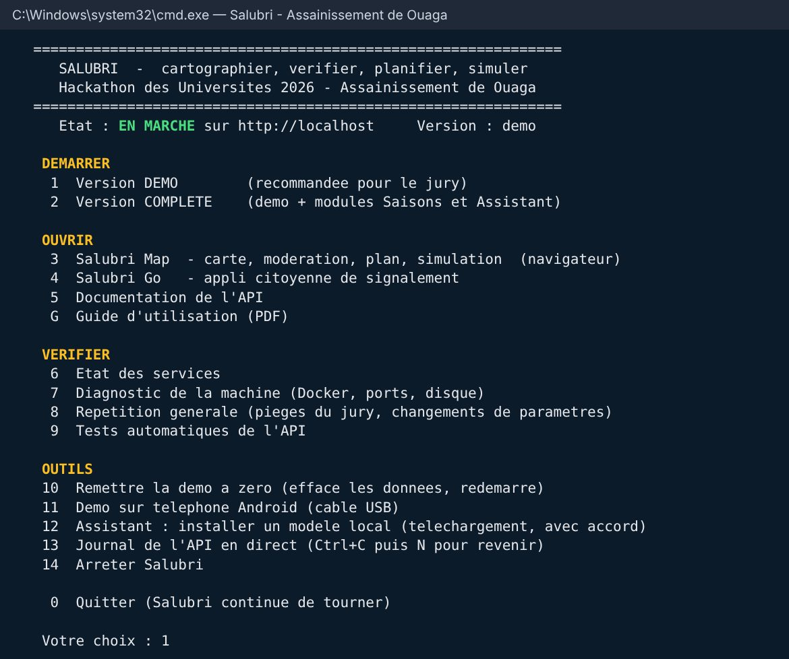
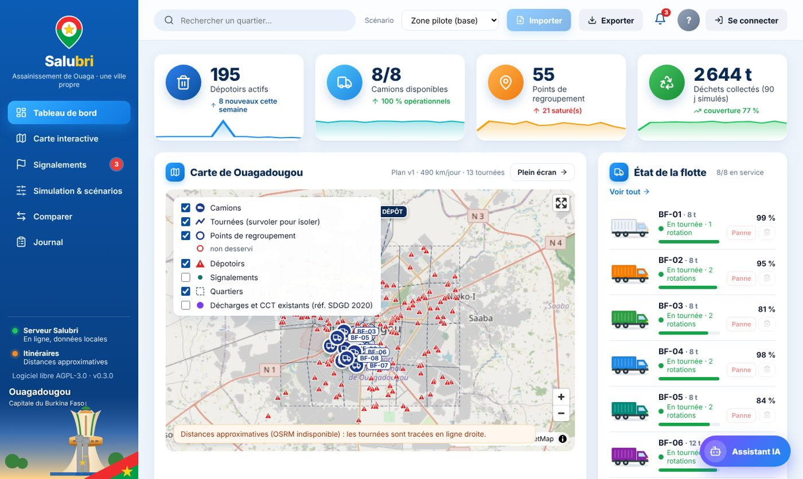
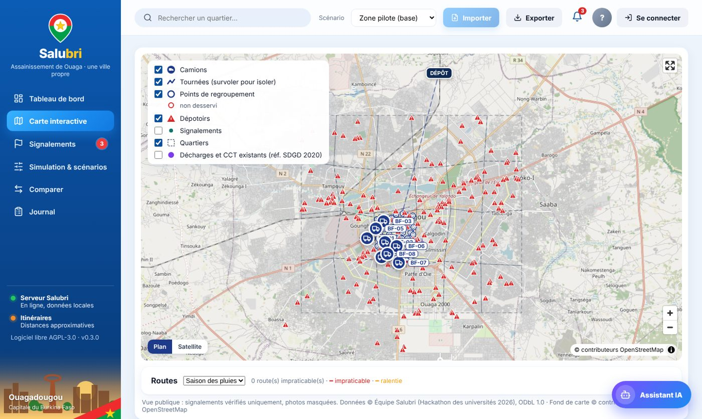
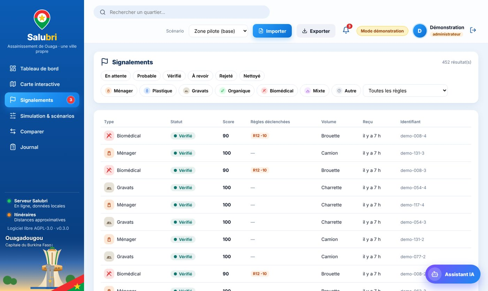
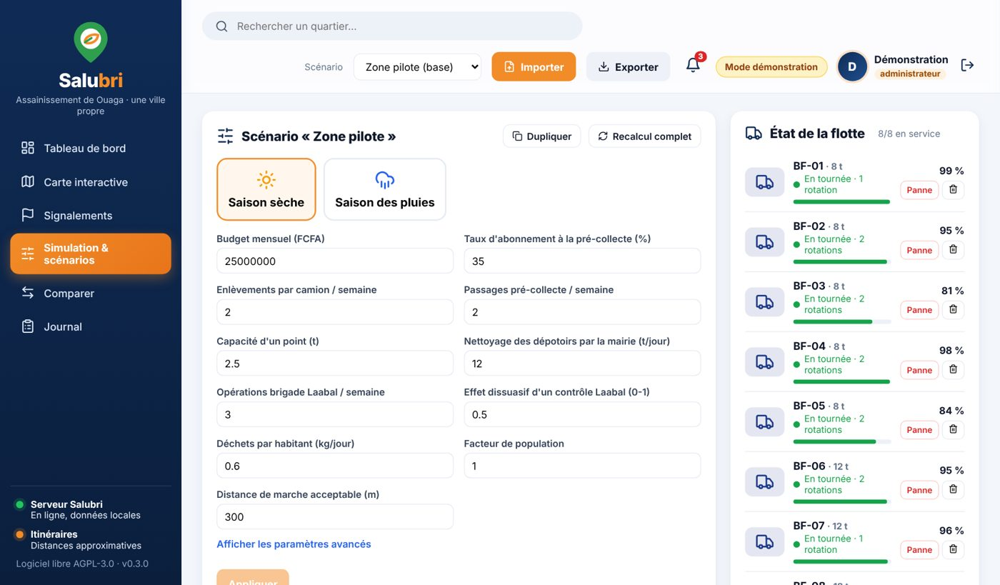
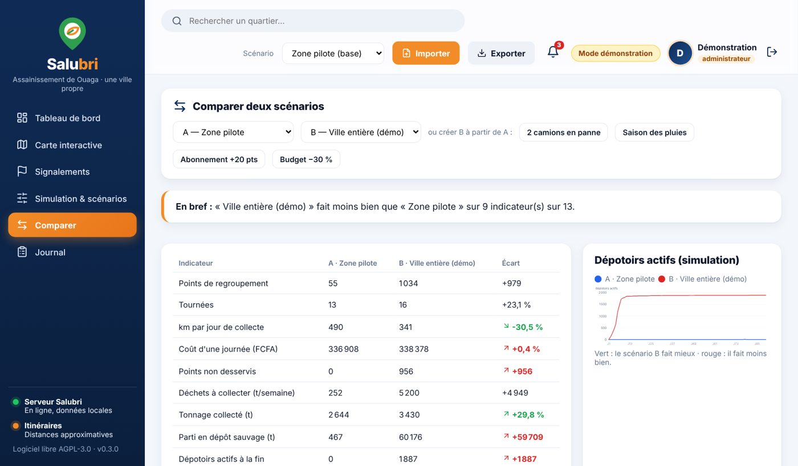
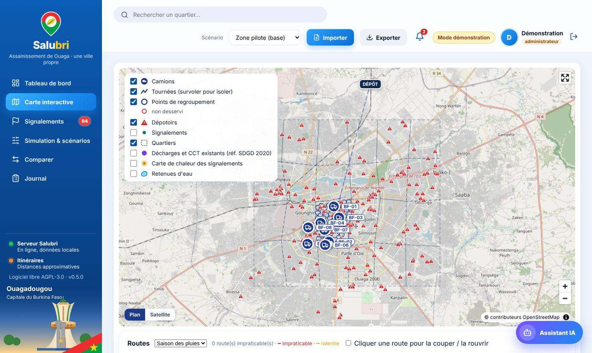
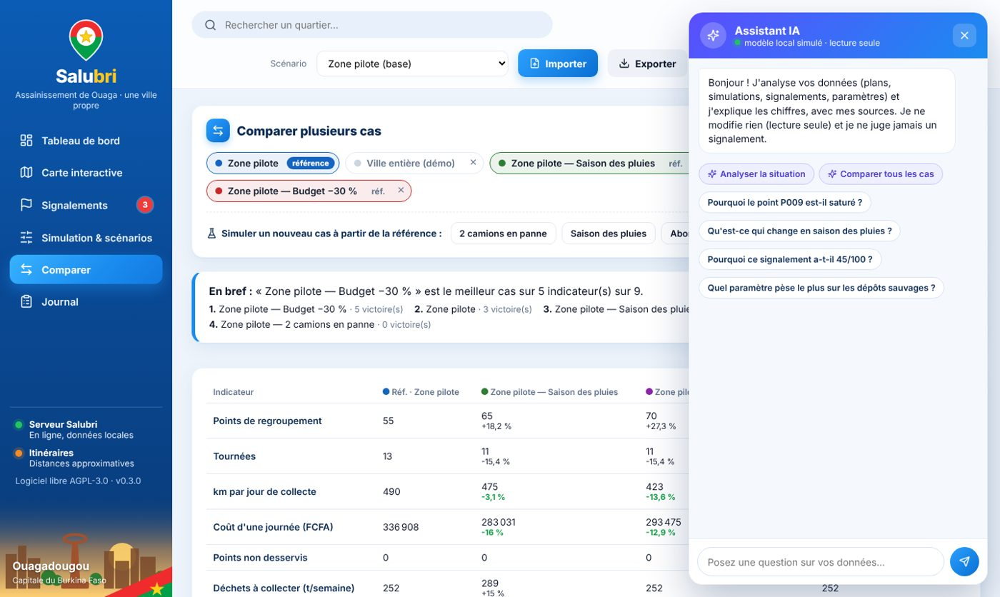

<!-- SPDX-License-Identifier: CC-BY-4.0 -->

Salubri

Guide de prise en main pour le jury

Hackathon des Universités 2026 · Challenge « Assainissement de Ouaga » · un seul fichier à lancer : <b>SALUBRI.bat</b>

Salubri aide la mairie à **cartographier** les dépotoirs sauvages signalés par les habitants, à **vérifier** chaque
signalement (12 règles, photos masquées), à **planifier** les points de regroupement et les tournées des camions, et
à **simuler** l'effet d'un changement (panne, saison des pluies, budget) avant de le décider.

> **En une phrase** : double-cliquez sur **`SALUBRI.bat`** à la racine du dossier, tapez **1** puis Entrée,
> attendez « Pret », et le navigateur s'ouvre sur Salubri. Compte de la mairie : **demo** / **ouaga2026**.

## 1. Ce qu'il faut sur l'ordinateur

| Besoin | Détail |
|---|---|
| Windows 10 ou 11 | `SALUBRI.bat` est le lanceur Windows (macOS ou Linux : `run/start.sh`, mêmes options dans `run/`) |
| **Docker Desktop**, démarré | <https://docs.docker.com/desktop/install/windows-install/> — l'icône de la baleine doit être immobile |
| 8 Go de mémoire, 10 Go de disque libre | 16 Go conseillés pour la version complète avec l'assistant |
| Ports 80 et 8443 libres | l'option 7 du menu le vérifie (Skype, IIS ou un autre serveur web peuvent les occuper) |
| Internet | seulement au **premier** démarrage (télécharger les images Docker) ; ensuite tout marche hors ligne |

Rien d'autre à installer : ni Node, ni Python, ni base de données (tout tourne dans Docker). Python n'est utile
que pour l'option 12 (installer un modèle pour l'assistant).

## 2. Le lanceur `SALUBRI.bat`

La ligne **État** dit si Salubri tourne et quelle version est choisie. Tapez le numéro (ou la lettre) puis Entrée ;
après chaque action, une touche ramène au menu.

| Choix | Ce que ça fait | Durée |
|---|---|---|
| **1** Version DEMO | démarre Salubri en mode démonstration : compte `demo`, modules optionnels éteints. **C'est la version à tester.** | 3–8 min la 1ʳᵉ fois, ~1 min ensuite |
| **2** Version COMPLÈTE | les **données de référence seules** (aucun signalement fictif) + le module **Saisons** (routes coupées en saison des pluies) + le module **Assistant** (modèle de langue local) | idem |
| **P** Purger | supprime tous les signalements et ce qui en découle, garde les données de référence (commande `python -m salubri_api.purge signalements`, confirmation : taper PURGER) | ~1 min |
| **3** Salubri Map | ouvre l'application de la mairie dans le navigateur | — |
| **4** Salubri Go | ouvre l'application citoyenne (signalement avec photo, hors ligne) | — |
| **5** API | documentation interactive de l'API (`/api/docs`) | — |
| **G** Guide | ouvre ce document | — |
| **6** État des services | conteneurs Docker et réponse de l'API | quelques s |
| **7** Diagnostic | Docker, ports, disque, carte utilisée, assistant | quelques s |
| **8** Répétition générale | rejoue les pièges du jury et des changements de paramètres, écrit `docs/REHEARSAL_REPORT.md` | 3–5 min |
| **9** Tests automatiques | les tests de l'API dans Docker | 4–6 min |
| **10** Remise à zéro | efface toutes les données et redémarre (demande « OUI ») | ~2 min |
| **11** Téléphone | démo de Salubri Go sur un téléphone Android branché en USB | — |
| **12** Assistant | cherche un modèle de langue déjà installé, sinon propose d'en télécharger un adapté à la machine (taille affichée, accord demandé) | selon le réseau |
| **13** Journal | messages de l'API en direct (Ctrl+C puis **N** pour revenir au menu) | — |
| **14** Arrêter | arrête Salubri (les données sont gardées) | ~10 s |
| **0** Quitter | ferme le menu ; Salubri continue de tourner | — |

## 3. Parcours conseillé pour le jury (10 minutes)

Démarrez la **version DEMO** (choix 1). Le navigateur s'ouvre sur le tableau de bord.

### Étape 1 — Le tableau de bord

Dépotoirs actifs, camions disponibles, points de regroupement, tonnes collectées simulées, carte de la ville et état
de la flotte. Une fois connecté avec le compte public « demo », le badge jaune « Mode démonstration » le rappelle.

### Étape 2 — Signaler un dépotoir avec Salubri Go

Choix **4** du menu (ou `http://localhost/go/`, aussi sur téléphone : choix 11). Prenez une photo : **les visages et
les plaques sont floutés sur l'appareil, avant tout envoi**. Choisissez le type de déchets et le volume, puis
« Envoyer ». Sans réseau, le signalement attend dans « Mes envois » et part tout seul au retour du réseau.

### Étape 3 — La carte et la vérification des signalements

Dans le cadre des couches, cochez **« Carte de chaleur des signalements »** (période au choix : 7, 30, 90 jours) pour
voir où les signalements se concentrent, et **« Retenues d'eau »** : barrages et lacs en bleu, dépotoirs à moins de 200 m
cerclés ; la liste par retenue est sous la carte. Les données sont réelles : bâtiments Google Open Buildings, voies et
eau OpenStreetMap, populations du recensement INSD 2019.

Le public ne voit que les signalements **vérifiés**, photos masquées (ligne de licence sous la carte). Cliquez
« Se connecter » en haut à droite : **demo** / **ouaga2026**.

Page « Signalements » : chaque signalement a un score sur 100 et les règles déclenchées (`R2` photo déjà utilisée,
`R5` hors commune, `R9` déplacement impossible…). Essayez d'envoyer **deux fois la même photo** : la seconde est
rejetée. Le modérateur garde le dernier mot (Vérifié / Rejeté).

### Étape 4 — Le plan et un changement de scénario

Page « Simulation & scénarios » : basculez **Saison des pluies**, ou mettez **deux camions en panne** dans « État de
la flotte ». Le plan se recalcule en quelques secondes en ne refaisant que les étapes touchées ; les points restent
en place autant que possible, et le résumé dit ce qui a changé.

### Étape 5 — Comparer

Page « Comparer » : **plusieurs cas côte à côte** (jusqu'à 8). Cliquez les noms pour les ajouter ou les retirer ; le
premier sert de référence (« réf. » pour en changer). Pour simuler un nouveau cas à partir de la référence : un clic
sur « 2 camions en panne », « Saison des pluies », « Abonnement +20 pts », « Budget −30 % », ou « Cas sur mesure »
(nombre de camions en panne, saison, abonnement, budget). Chaque ligne du tableau montre le meilleur cas (coupe) et
l'écart à la référence ; « En bref » classe les cas. Les comportements des ménages sont des hypothèses : ces chiffres
servent à **comparer** des choix, pas à prédire. En version complète, « Analyser avec l'IA » demande à l'assistant
une recommandation chiffrée.

### Étape 6 — Récidive et brigade Laabal

Connecté, ouvrez un dépotoir sur la carte du tableau de bord et cliquez « Marquer nettoyé ». S'il est à nouveau
signalé au même endroit, il devient **récidiviste** et part **tout seul** à la brigade Laabal (ligne dans le journal).
La carte « Brigade Laabal : zones récidivistes » du tableau de bord liste les quartiers en alerte ; « Prévenir Laabal
sur WhatsApp » ouvre la discussion avec le message prêt (lieux, volumes, liens de carte) : rien ne part sans votre clic.
Le numéro +226 00 00 00 00 est **fictif** (à remplacer dans `.env` : `SALUBRI_LAABAL_WHATSAPP`). Un dépotoir dans ou
au bord d'un **caniveau** (données OpenStreetMap) est signalé en rouge et passe en priorité × 2 : il bouche
l'écoulement et provoque des inondations en saison des pluies.

### Étape 7 — Le journal

Page « Journal » : chaque action (connexion, modération, changement de scénario) est tracée, en phrases lisibles.

## 4. La version complète (choix 2) — modules optionnels

Ces deux modules ne font pas partie des livrables exigés. Éteints (version démo), ils ne changent rien.

**Saisons.** Sous la carte, le panneau « Routes » : connecté, cochez « Cliquer une route pour la couper » puis
cliquez une route de la carte. En saison des pluies, chaque point de regroupement dont la route d'accès est coupée
est **déplacé** (en gardant ses ménages à portée de marche) ou signalé **inaccessible** ; un CCT existant n'est
jamais déplacé. Le panneau liste les points touchés et pourquoi ; revenir en saison sèche remet chaque point à sa
place. Dans Salubri Go, l'onglet « Route » permet de signaler une route impraticable (vérifiée par la mairie).

**Assistant IA.** Bulle « Assistant IA » en bas à droite, sur toutes les pages ; il faut être connecté (demo /
ouaga2026) pour poser une question. « Analyser la situation » et « Comparer tous les cas » lui font lire vos données
(dépotoirs, signalements, flotte, scénarios simulés) et en tirer une analyse chiffrée. Il explique aussi un plan, un
point saturé, un score de signalement ou un paramètre, en citant ses sources ; **il ne modifie rien** et ne juge
jamais un signalement. En haut du panneau, un point vert indique que le modèle de langue répond. Il lui faut un modèle de langue local : s'il répond « Assistant indisponible », utilisez le choix
**12** (un modèle déjà installé — Ollama, LM Studio… — est utilisé tel quel ; sinon un modèle adapté à la machine
est proposé, de 1 à 9 Go, **après accord**), puis relancez le choix 2. Si Ollama tourne déjà sur le PC, le choix 2
le trouve tout seul.

## 5. Si quelque chose ne marche pas

| Ce que vous voyez | Que faire |
|---|---|
| « Docker n'est pas installé » ou « ne tourne pas » | installer ou démarrer Docker Desktop, attendre la baleine immobile, relancer |
| Port 80 ou 8443 en ÉCHEC (choix 7) | fermer le logiciel qui l'occupe, ou mettre `WEB_PORT=8080` dans `.env` (le menu en tient compte) |
| « L'API ne répond pas » | choix 6 (état) puis 13 (journal) ; au premier démarrage, attendre quelques minutes de plus |
| La page reste blanche | rafraîchir (Ctrl+F5) ; vérifier l'adresse `http://localhost` |
| Données de test en désordre | choix 10 (remise à zéro), puis choix 1 |
| GPS refusé sur téléphone | utiliser le câble USB (choix 11) ou `https://<adresse-du-PC>:8443/go/` en Wi-Fi |
| L'assistant dit « indisponible » (point rouge) | ouvrir l'application Ollama : il la retrouve seul en quelques secondes ; sinon choix 12, puis choix 2. La démo fonctionne sans lui |
| Ollama ouvert mais toujours rouge | quitter Ollama, définir la variable d'environnement Windows `OLLAMA_HOST=0.0.0.0`, rouvrir Ollama |

## 6. Repères

- Comptes : **demo** / **ouaga2026** (administrateur, mode démonstration seulement ; c'est lui qui affiche le badge « Mode démonstration »). Compte personnel : `docker compose exec api python -m salubri_api.users add <login> --role admin`.
- Application Android : l'APK de Salubri Go se télécharge dans GitHub (Actions, artefact `salubri-go-apk`) ; au premier lancement, taper l'adresse du serveur affichée par `run/start` (même Wi-Fi). Détails : `apps/go/README.md`. Hors démonstration
  (`SALUBRI_DEMO_MODE=false`), des secrets aléatoires sont créés au premier démarrage et un admin se crée avec
  `run\admin <login>`.
- Adresses : Salubri Map `http://localhost/` · Salubri Go `http://localhost/go/` · API `http://localhost/api/docs`.
- Données de la démonstration : carte synthétique de Ouagadougou, quartiers et populations de démonstration ;
  avec l'extrait OpenStreetMap (`data/osm/ouaga.osm.pbf`), vraies rues et itinéraires routiers.
- Pour aller plus loin : `README.md`, `docs/RAPPORT_TECHNIQUE.pdf`, `docs/DEMO.md`, `docs/MODULES.md`.
- Logiciel libre (AGPL-3.0), données sous ODbL 1.0.
