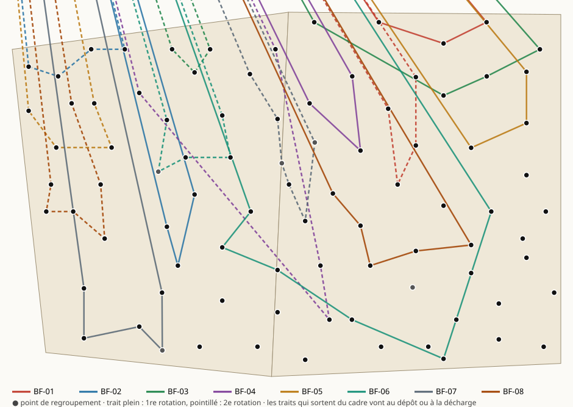

<!-- SPDX-License-Identifier: CC-BY-4.0 -->
# Plan de collecte — Arrondissement 9 de Ouagadougou

Généré par `scripts/plan_arrondissement.py --arrondissement 9` le 2026-11-17, plan v2 du scénario « Arrondissement 9 » ; simulations du modèle à agents, 30 réplications par variante, médiane [intervalle à 90 %]. Ne pas modifier à la main : relancer le script.

> **Données de démonstration.** Les limites et populations des quartiers de cet arrondissement viennent du jeu de démonstration (`quartiers.geojson`, `source: demo`) : Arrondissement 9 — Nord (49 100 hab.), Arrondissement 9 — Sud (56 100 hab.). Les bâtiments sont réels (Open Buildings) mais les populations sont des ordres de grandeur. Remplacer par les limites des secteurs et les populations du recensement (INSD) avant tout usage, puis relancer.

> **Population réelle** : 336 483 habitants en 2019 (INSD, RGPH 2019, monographie de la commune de Ouagadougou, tableau 2.2), soit 3,2 fois la population de démonstration ci-dessous. Les tonnages, le nombre de points et de camions sont donc à multiplier d'autant ; les limites des secteurs 37 à 40 ne sont pas publiées en données ouvertes (absentes de l'extrait OSM) : **à faire par l'équipe** (demander la carte des secteurs à la mairie d'arrondissement, la charger dans `quartiers.geojson`).

## En bref

- **Population couverte** : 105 200 habitants ; **demande** 441,8 t/semaine.
- **87 points de regroupement** (capacité 2,5 t), couverture à 300 m de marche : 95 % de la population.
- **8 camion(s)** (BF-01, BF-02, BF-03, BF-04, BF-05, BF-06, BF-07, BF-08), 16 tournée(s) par jour d'enlèvement (lundi, mercredi, vendredi), 452,0 km, **391 487 FCFA** par jour d'enlèvement.
- Points non desservis : 1 ; camions nécessaires pour tout desservir : 9 (disponibles : 8).

## Capacité des points et flotte

- **Capacité par enlèvement** (contrainte du placement) : 3 enlèvement(s) par semaine (demandé : 2) ; chaque point tient dans son bac à chaque enlèvement.

Flotte nécessaire : 1 camion(s) de 8 t de plus, ajoutés un par un jusqu'à ce que tous les points soient desservis (simulation : 30 réplications, médiane [intervalle à 90 %], 90 jours).

| Flotte | Camions | Points non desservis | Tonnes non enlevées par enlèvement | Coût par jour (FCFA) | Coût par mois (FCFA) | Dépôts sauvages simulés (t) | Couverture simulée (%) |
|---|---|---|---|---|---|---|---|
| Flotte actuelle | 8 | 1 | 1,9 | 391 487 | 5 089 331 | 606,1 [548,4 ; 695,8] | 87 [86 ; 89] |
| Flotte nécessaire | 9 | 0 | 0,0 | 398 396 | 5 179 148 | 523,6 [482,3 ; 566,1] | 89 [88 ; 90] |

## Tournées (par jour d'enlèvement)

| Camion | Rotation | Jours | 1er passage | Dernier passage | Points | Tonnage (t) | km | Coût (FCFA) |
|---|---|---|---|---|---|---|---|---|
| BF-01 | 1 | lundi, mercredi, vendredi | 07:00 | 07:35 | 4 | 7,5 | 28,4 | 32 778 |
| BF-01 | 2 | lundi, mercredi, vendredi | 08:40 | 09:14 | 4 | 7,6 | 22,4 | 10 062 |
| BF-02 | 1 | lundi, mercredi, vendredi | 07:00 | 07:35 | 4 | 7,6 | 27,7 | 32 470 |
| BF-02 | 2 | lundi, mercredi, vendredi | 08:38 | 09:13 | 4 | 7,2 | 22,7 | 10 211 |
| BF-03 | 1 | lundi, mercredi, vendredi | 07:00 | 07:59 | 6 | 7,8 | 28,2 | 32 674 |
| BF-03 | 2 | lundi, mercredi, vendredi | 09:05 | 09:51 | 5 | 7,7 | 24,4 | 10 960 |
| BF-04 | 1 | lundi, mercredi, vendredi | 07:00 | 07:45 | 5 | 7,7 | 30,4 | 33 662 |
| BF-04 | 2 | lundi, mercredi, vendredi | 08:56 | 09:32 | 4 | 7,7 | 24,8 | 11 151 |
| BF-05 | 1 | lundi, mercredi, vendredi | 07:00 | 07:35 | 4 | 7,7 | 29,9 | 33 466 |
| BF-05 | 2 | lundi, mercredi, vendredi | 08:46 | 09:33 | 5 | 7,4 | 26,0 | 11 694 |
| BF-06 | 1 | lundi, mercredi, vendredi | 07:00 | 07:58 | 6 | 11,4 | 32,3 | 41 781 |
| BF-06 | 2 | lundi, mercredi, vendredi | 09:10 | 10:35 | 8 | 11,7 | 30,5 | 15 836 |
| BF-07 | 1 | lundi, mercredi, vendredi | 07:00 | 08:13 | 7 | 11,9 | 34,4 | 42 913 |
| BF-07 | 2 | lundi, mercredi, vendredi | 09:27 | 10:36 | 7 | 11,6 | 27,7 | 14 423 |
| BF-08 | 1 | lundi, mercredi, vendredi | 07:00 | 07:59 | 6 | 11,5 | 33,5 | 42 428 |
| BF-08 | 2 | lundi, mercredi, vendredi | 09:17 | 10:28 | 7 | 11,4 | 28,8 | 14 978 |

## Points de regroupement

| Point | Position (lat, lon) | Quartier servi | Capacité (t) | Demande (t/sem.) | Remplissage par enlèvement | Îlots | Jours d'enlèvement | Créneau | Camion | Passage |
|---|---|---|---|---|---|---|---|---|---|---|
| CCT-078 | 12.39468, -1.46454 | Arrondissement 9 — Sud | 2,5 | 6,85 | 91 % | 2 | lundi, mercredi, vendredi | 07:00–17:00 | BF-08 r2 | 10:15 |
| CCT-079 | 12.39261, -1.46783 | Arrondissement 9 — Sud | 2,5 | 5,92 | 79 % | 2 | lundi, mercredi, vendredi | 07:00–17:00 | BF-05 r2 | 09:21 |
| CCT-080 | 12.39177, -1.48015 | Arrondissement 9 — Nord | 2,5 | 5,91 | 79 % | 2 | lundi, mercredi, vendredi | 07:00–17:00 | BF-07 r2 | 10:36 |
| CCT-084 | 12.38024, -1.45478 | Arrondissement 9 — Sud | 2,5 | 5,73 | 76 % | 2 | lundi, mercredi, vendredi | 07:00–17:00 | BF-08 r1 | 07:11 |
| CCT-086 | 12.37396, -1.47975 | Arrondissement 9 — Nord | 2,5 | 3,57 | 48 % | 1 | lundi, mercredi, vendredi | 07:00–17:00 | BF-04 r1 | 07:24 |
| P001 | 12.40268, -1.45170 | Arrondissement 9 — Sud | 2,5 | 2,94 | 39 % | 1 | lundi, mercredi, vendredi | 07:00–17:00 | BF-03 r1 | 07:59 |
| P002 | 12.38780, -1.46725 | Arrondissement 9 — Sud | 2,5 | 7,43 | 99 % | 3 | lundi, mercredi, vendredi | 07:00–17:00 | BF-01 r1 | 07:00 |
| P003 | 12.39588, -1.48958 | Arrondissement 9 — Nord | 2,5 | 6,90 | 92 % | 2 | lundi, mercredi, vendredi | 07:00–17:00 | BF-04 r2 | 09:07 |
| P004 | 12.38798, -1.44894 | Arrondissement 9 — Sud | 2,5 | 5,28 | 70 % | 2 | lundi, mercredi, vendredi | 07:00–17:00 | BF-06 r2 | 09:57 |
| P005 | 12.39738, -1.47377 | Arrondissement 9 — Nord | 2,5 | 6,19 | 82 % | 2 | lundi, mercredi, vendredi | 07:00–17:00 | BF-08 r2 | 10:28 |
| P006 | 12.37702, -1.45042 | Arrondissement 9 — Sud | 2,5 | 3,95 | 53 % | 1 | lundi, mercredi, vendredi | 07:00–17:00 | BF-08 r1 | 07:23 |
| P007 | 12.39588, -1.46003 | Arrondissement 9 — Sud | 2,5 | 3,78 | 50 % | 1 | lundi, mercredi, vendredi | 07:00–17:00 | BF-08 r2 | 09:17 |
| P008 | 12.38241, -1.46336 | Arrondissement 9 — Sud | 2,5 | 7,02 | 94 % | 2 | lundi, mercredi, vendredi | 07:00–17:00 | BF-06 r1 | 07:00 |
| P009 | 12.39049, -1.44420 | Arrondissement 9 — Sud | 2,5 | 4,21 | 56 % | 1 | lundi, mercredi, vendredi | 07:00–17:00 | BF-07 r1 | 08:13 |
| P010 | 12.38423, -1.47377 | Arrondissement 9 — Nord | 2,5 | 6,30 | 84 % | 2 | lundi, mercredi, vendredi | 07:00–17:00 | BF-01 r1 | 07:23 |
| P011 | 12.39049, -1.49085 | Arrondissement 9 — Nord | 2,5 | 3,83 | 51 % | 1 | lundi, mercredi, vendredi | 07:00–17:00 | BF-07 r2 | 09:27 |
| P012 | 12.40666, -1.46729 | Arrondissement 9 — Nord | 2,5 | 3,85 | 51 % | 2 | lundi, mercredi, vendredi | 07:00–17:00 | BF-03 r2 | 09:51 |
| P013 | 12.37971, -1.44203 | Arrondissement 9 — Sud | 2,5 | 7,21 | 96 % | 2 | lundi, mercredi, vendredi | 07:00–17:00 | BF-07 r1 | 07:24 |
| P014 | 12.37432, -1.47139 | Arrondissement 9 — Nord | 2,5 | 5,63 | 75 % | 2 | — | 07:00–17:00 | non desservi | — |
| P015 | 12.38983, -1.45722 | Arrondissement 9 — Sud | 2,5 | 5,01 | 67 % | 2 | lundi, mercredi, vendredi | 07:00–17:00 | BF-08 r2 | 09:40 |
| P016 | 12.37432, -1.45793 | Arrondissement 9 — Sud | 2,5 | 6,69 | 89 % | 2 | lundi, mercredi, vendredi | 07:00–17:00 | BF-06 r1 | 07:23 |
| P017 | 12.38949, -1.47653 | Arrondissement 9 — Nord | 2,5 | 4,89 | 65 % | 1 | lundi, mercredi, vendredi | 07:00–17:00 | BF-07 r2 | 10:25 |
| P018 | 12.37517, -1.48757 | Arrondissement 9 — Nord | 2,5 | 5,53 | 74 % | 3 | lundi, mercredi, vendredi | 07:00–17:00 | BF-04 r1 | 07:11 |
| P019 | 12.38510, -1.48393 | Arrondissement 9 — Nord | 2,5 | 6,02 | 80 % | 2 | lundi, mercredi, vendredi | 07:00–17:00 | BF-07 r2 | 10:01 |
| P020 | 12.39759, -1.47929 | Arrondissement 9 — Nord | 2,5 | 5,12 | 68 % | 1 | lundi, mercredi, vendredi | 07:00–17:00 | BF-05 r2 | 08:46 |
| P021 | 12.39319, -1.44193 | Arrondissement 9 — Sud | 2,5 | 4,16 | 55 % | 1 | lundi, mercredi, vendredi | 07:00–17:00 | BF-07 r1 | 07:00 |
| P022 | 12.38683, -1.45722 | Arrondissement 9 — Sud | 2,5 | 3,35 | 45 % | 1 | lundi, mercredi, vendredi | 07:00–17:00 | BF-06 r2 | 10:21 |
| P023 | 12.37926, -1.47377 | Arrondissement 9 — Nord | 2,5 | 6,95 | 93 % | 2 | lundi, mercredi, vendredi | 07:00–17:00 | BF-05 r1 | 07:35 |
| P024 | 12.39858, -1.45223 | Arrondissement 9 — Sud | 2,5 | 5,13 | 68 % | 2 | lundi, mercredi, vendredi | 07:00–17:00 | BF-03 r1 | 07:47 |
| P025 | 12.37863, -1.44618 | Arrondissement 9 — Sud | 2,5 | 5,64 | 75 % | 2 | lundi, mercredi, vendredi | 07:00–17:00 | BF-07 r1 | 07:49 |
| P026 | 12.39319, -1.47295 | Arrondissement 9 — Nord | 2,5 | 3,67 | 49 % | 1 | lundi, mercredi, vendredi | 07:00–17:00 | BF-05 r2 | 09:09 |
| P027 | 12.37303, -1.46550 | Arrondissement 9 — Sud | 2,5 | 4,53 | 60 % | 1 | lundi, mercredi, vendredi | 07:00–17:00 | BF-06 r1 | 07:36 |
| P028 | 12.39319, -1.45640 | Arrondissement 9 — Sud | 2,5 | 3,99 | 53 % | 1 | lundi, mercredi, vendredi | 07:00–17:00 | BF-08 r2 | 09:28 |
| P029 | 12.39779, -1.44342 | Arrondissement 9 — Sud | 2,5 | 6,86 | 91 % | 2 | lundi, mercredi, vendredi | 07:00–17:00 | BF-02 r1 | 07:22 |
| P030 | 12.38387, -1.45446 | Arrondissement 9 — Sud | 2,5 | 6,23 | 83 % | 2 | lundi, mercredi, vendredi | 07:00–17:00 | BF-06 r2 | 10:09 |
| P031 | 12.39588, -1.48375 | Arrondissement 9 — Nord | 2,5 | 7,08 | 94 % | 2 | lundi, mercredi, vendredi | 07:00–17:00 | BF-04 r2 | 09:32 |
| P032 | 12.40666, -1.46166 | Arrondissement 9 — Sud | 2,5 | 5,67 | 76 % | 2 | lundi, mercredi, vendredi | 07:00–17:00 | BF-03 r2 | 09:05 |
| P033 | 12.38510, -1.44320 | Arrondissement 9 — Sud | 2,5 | 7,26 | 97 % | 2 | lundi, mercredi, vendredi | 07:00–17:00 | BF-07 r1 | 08:01 |
| P034 | 12.38780, -1.47182 | Arrondissement 9 — Nord | 2,5 | 5,28 | 70 % | 2 | lundi, mercredi, vendredi | 07:00–17:00 | BF-01 r1 | 07:35 |
| P035 | 12.37647, -1.45998 | Arrondissement 9 — Sud | 2,5 | 4,26 | 57 % | 1 | lundi, mercredi, vendredi | 07:00–17:00 | BF-06 r1 | 07:12 |
| P036 | 12.39100, -1.46274 | Arrondissement 9 — Sud | 2,5 | 5,42 | 72 % | 2 | lundi, mercredi, vendredi | 07:00–17:00 | BF-08 r2 | 10:03 |
| P037 | 12.38780, -1.48852 | Arrondissement 9 — Nord | 2,5 | 4,82 | 64 % | 1 | lundi, mercredi, vendredi | 07:00–17:00 | BF-07 r2 | 09:49 |
| P038 | 12.38241, -1.47820 | Arrondissement 9 — Nord | 2,5 | 4,67 | 62 % | 1 | lundi, mercredi, vendredi | 07:00–17:00 | BF-05 r1 | 07:00 |
| P039 | 12.40231, -1.46826 | Arrondissement 9 — Nord | 2,5 | 3,21 | 43 % | 1 | lundi, mercredi, vendredi | 07:00–17:00 | BF-03 r2 | 09:40 |
| P040 | 12.37506, -1.44618 | Arrondissement 9 — Sud | 2,5 | 5,93 | 79 % | 2 | lundi, mercredi, vendredi | 07:00–17:00 | BF-08 r1 | 07:46 |
| P041 | 12.37432, -1.47603 | Arrondissement 9 — Nord | 2,5 | 6,32 | 84 % | 2 | lundi, mercredi, vendredi | 07:00–17:00 | BF-05 r1 | 07:23 |
| P042 | 12.40666, -1.44741 | Arrondissement 9 — Sud | 2,5 | 3,99 | 53 % | 1 | lundi, mercredi, vendredi | 07:00–17:00 | BF-02 r1 | 07:35 |
| P043 | 12.40397, -1.48104 | Arrondissement 9 — Nord | 2,5 | 6,04 | 81 % | 3 | lundi, mercredi, vendredi | 07:00–17:00 | BF-02 r2 | 08:38 |
| P044 | 12.38628, -1.47929 | Arrondissement 9 — Nord | 2,5 | 5,47 | 73 % | 2 | lundi, mercredi, vendredi | 07:00–17:00 | BF-07 r2 | 10:13 |
| P045 | 12.37432, -1.44171 | Arrondissement 9 — Sud | 2,5 | 3,52 | 47 % | 1 | lundi, mercredi, vendredi | 07:00–17:00 | BF-07 r1 | 07:36 |
| P046 | 12.38928, -1.45170 | Arrondissement 9 — Sud | 2,5 | 3,50 | 47 % | 1 | lundi, mercredi, vendredi | 07:00–17:00 | BF-06 r2 | 09:46 |
| P047 | 12.38241, -1.45901 | Arrondissement 9 — Sud | 2,5 | 5,41 | 72 % | 2 | lundi, mercredi, vendredi | 07:00–17:00 | BF-08 r1 | 07:00 |
| P048 | 12.40560, -1.45170 | Arrondissement 9 — Sud | 2,5 | 3,92 | 52 % | 1 | lundi, mercredi, vendredi | 07:00–17:00 | BF-03 r1 | 07:00 |
| P049 | 12.38241, -1.46981 | Arrondissement 9 — Nord | 2,5 | 3,53 | 47 % | 1 | lundi, mercredi, vendredi | 07:00–17:00 | BF-01 r1 | 07:12 |
| P050 | 12.38780, -1.44150 | Arrondissement 9 — Sud | 2,5 | 3,56 | 47 % | 1 | lundi, mercredi, vendredi | 07:00–17:00 | BF-07 r1 | 07:11 |
| P051 | 12.40397, -1.44208 | Arrondissement 9 — Sud | 2,5 | 5,78 | 77 % | 2 | lundi, mercredi, vendredi | 07:00–17:00 | BF-02 r1 | 07:00 |
| P052 | 12.40127, -1.46081 | Arrondissement 9 — Sud | 2,5 | 3,57 | 48 % | 1 | lundi, mercredi, vendredi | 07:00–17:00 | BF-03 r2 | 09:17 |
| P053 | 12.40483, -1.47377 | Arrondissement 9 — Nord | 2,5 | 5,43 | 72 % | 2 | lundi, mercredi, vendredi | 07:00–17:00 | BF-02 r2 | 09:13 |
| P054 | 12.38780, -1.49164 | Arrondissement 9 — Nord | 2,5 | 3,75 | 50 % | 1 | lundi, mercredi, vendredi | 07:00–17:00 | BF-07 r2 | 09:38 |
| P055 | 12.40127, -1.44715 | Arrondissement 9 — Sud | 2,5 | 3,62 | 48 % | 1 | lundi, mercredi, vendredi | 07:00–17:00 | BF-03 r1 | 07:12 |
| P056 | 12.38638, -1.45998 | Arrondissement 9 — Sud | 2,5 | 3,06 | 41 % | 1 | lundi, mercredi, vendredi | 07:00–17:00 | BF-08 r2 | 09:51 |
| P057 | 12.39804, -1.45722 | Arrondissement 9 — Sud | 2,5 | 2,88 | 38 % | 1 | lundi, mercredi, vendredi | 07:00–17:00 | BF-06 r2 | 10:35 |
| P058 | 12.39319, -1.45334 | Arrondissement 9 — Sud | 2,5 | 5,73 | 76 % | 2 | lundi, mercredi, vendredi | 07:00–17:00 | BF-06 r2 | 09:34 |
| P059 | 12.40058, -1.44342 | Arrondissement 9 — Sud | 2,5 | 6,15 | 82 % | 2 | lundi, mercredi, vendredi | 07:00–17:00 | BF-02 r1 | 07:11 |
| P060 | 12.39319, -1.44739 | Arrondissement 9 — Sud | 2,5 | 3,34 | 44 % | 1 | lundi, mercredi, vendredi | 07:00–17:00 | BF-03 r1 | 07:25 |
| P061 | 12.39509, -1.44894 | Arrondissement 9 — Sud | 2,5 | 4,56 | 61 % | 2 | lundi, mercredi, vendredi | 07:00–17:00 | BF-03 r1 | 07:36 |
| P062 | 12.39753, -1.46826 | Arrondissement 9 — Nord | 2,5 | 3,17 | 42 % | 1 | lundi, mercredi, vendredi | 07:00–17:00 | BF-05 r2 | 09:33 |
| P063 | 12.40058, -1.46550 | Arrondissement 9 — Sud | 2,5 | 6,80 | 91 % | 2 | lundi, mercredi, vendredi | 07:00–17:00 | BF-03 r2 | 09:29 |
| P064 | 12.40241, -1.45446 | Arrondissement 9 — Sud | 2,5 | 2,95 | 39 % | 1 | lundi, mercredi, vendredi | 07:00–17:00 | BF-06 r2 | 09:21 |
| P065 | 12.40424, -1.45722 | Arrondissement 9 — Sud | 2,5 | 5,19 | 69 % | 2 | lundi, mercredi, vendredi | 07:00–17:00 | BF-06 r2 | 09:10 |
| P066 | 12.40028, -1.47377 | Arrondissement 9 — Nord | 2,5 | 3,92 | 52 % | 1 | lundi, mercredi, vendredi | 07:00–17:00 | BF-02 r2 | 09:01 |
| P067 | 12.40180, -1.47653 | Arrondissement 9 — Nord | 2,5 | 6,13 | 82 % | 2 | lundi, mercredi, vendredi | 07:00–17:00 | BF-02 r2 | 08:50 |
| P068 | 12.40127, -1.48326 | Arrondissement 9 — Nord | 2,5 | 5,88 | 78 % | 2 | lundi, mercredi, vendredi | 07:00–17:00 | BF-01 r2 | 09:14 |
| P069 | 12.40180, -1.49309 | Arrondissement 9 — Nord | 2,5 | 3,73 | 50 % | 1 | lundi, mercredi, vendredi | 07:00–17:00 | BF-01 r2 | 08:40 |
| P070 | 12.40089, -1.49033 | Arrondissement 9 — Nord | 2,5 | 5,96 | 80 % | 2 | lundi, mercredi, vendredi | 07:00–17:00 | BF-01 r2 | 08:51 |
| P071 | 12.40127, -1.48685 | Arrondissement 9 — Nord | 2,5 | 7,37 | 98 % | 2 | lundi, mercredi, vendredi | 07:00–17:00 | BF-01 r2 | 09:02 |
| P072 | 12.39588, -1.49223 | Arrondissement 9 — Nord | 2,5 | 5,52 | 74 % | 2 | lundi, mercredi, vendredi | 07:00–17:00 | BF-04 r2 | 08:56 |
| P073 | 12.39319, -1.47743 | Arrondissement 9 — Nord | 2,5 | 4,24 | 56 % | 1 | lundi, mercredi, vendredi | 07:00–17:00 | BF-05 r2 | 08:57 |
| P074 | 12.39049, -1.48685 | Arrondissement 9 — Nord | 2,5 | 3,67 | 49 % | 1 | lundi, mercredi, vendredi | 07:00–17:00 | BF-04 r2 | 09:19 |
| P075 | 12.37971, -1.48774 | Arrondissement 9 — Nord | 2,5 | 6,38 | 85 % | 2 | lundi, mercredi, vendredi | 07:00–17:00 | BF-04 r1 | 07:00 |
| P076 | 12.37702, -1.48147 | Arrondissement 9 — Nord | 2,5 | 3,29 | 44 % | 1 | lundi, mercredi, vendredi | 07:00–17:00 | BF-04 r1 | 07:45 |
| P077 | 12.37617, -1.48205 | Arrondissement 9 — Nord | 2,5 | 4,34 | 58 % | 1 | lundi, mercredi, vendredi | 07:00–17:00 | BF-04 r1 | 07:35 |
| P078 | 12.37971, -1.47967 | Arrondissement 9 — Nord | 2,5 | 5,13 | 68 % | 2 | lundi, mercredi, vendredi | 07:00–17:00 | BF-05 r1 | 07:11 |
| P079 | 12.37702, -1.46577 | Arrondissement 9 — Sud | 2,5 | 5,19 | 69 % | 2 | lundi, mercredi, vendredi | 07:00–17:00 | BF-06 r1 | 07:47 |
| P080 | 12.37953, -1.46826 | Arrondissement 9 — Sud | 2,5 | 6,61 | 88 % | 2 | lundi, mercredi, vendredi | 07:00–17:00 | BF-06 r1 | 07:58 |
| P081 | 12.38166, -1.44894 | Arrondissement 9 — Sud | 2,5 | 6,88 | 92 % | 2 | lundi, mercredi, vendredi | 07:00–17:00 | BF-08 r1 | 07:59 |
| P082 | 12.37434, -1.45170 | Arrondissement 9 — Sud | 2,5 | 6,52 | 87 % | 2 | lundi, mercredi, vendredi | 07:00–17:00 | BF-08 r1 | 07:34 |

## Coûts et personnel

- Coût par jour d'enlèvement : 391 487 FCFA, soit ~5 089 331 FCFA par mois (3.0 enlèvements par semaine).
- Personnel par jour d'enlèvement : 8 chauffeur(s) et 16 ripeur(s) (hypothèse : un chauffeur et deux ripeurs par camion).

## Indicateurs simulés (90 jours)

| Indicateur | Référence | Flotte nécessaire | 2 camions en panne | Saison des pluies | Abonnements +20 % | Budget −30 % | Pluies + 2 camions en panne |
|---|---|---|---|---|---|---|---|
| Tonnes collectées par camion | 4 958,6 [4 869,4 ; 5 031,8] | 5 046,1 [5 008,9 ; 5 105,3] | 4 024,9 [3 944,3 ; 4 052,4] | 5 056,9 [4 993,1 ; 5 140,0] | 4 951,3 [4 868,2 ; 4 999,0] | 4 958,6 [4 869,4 ; 5 031,8] | 4 017,7 [3 894,7 ; 4 062,2] |
| Tonnes pré-collectées | 311,6 [311,6 ; 311,7] | 311,6 [311,6 ; 311,7] | 311,6 [311,6 ; 311,7] | 311,8 [311,7 ; 311,9] | 311,8 [311,8 ; 311,9] | 311,6 [311,6 ; 311,7] | 311,8 [311,7 ; 311,9] |
| Tonnes en dépôt sauvage | 606,1 [548,4 ; 695,8] | 523,6 [482,3 ; 566,1] | 1 595,8 [1 549,8 ; 1 679,3] | 1 414,4 [1 359,0 ; 1 505,1] | 614,8 [564,7 ; 685,1] | 606,1 [548,4 ; 695,8] | 2 374,7 [2 336,5 ; 2 508,1] |
| Dépotoirs actifs (moyenne) | 0,5 [0,0 ; 2,4] | 0,2 [0,0 ; 0,7] | 97,7 [91,1 ; 110,0] | 100,4 [94,7 ; 109,7] | 0,6 [0,0 ; 1,9] | 0,5 [0,0 ; 2,4] | 111,2 [106,3 ; 122,6] |
| Couverture simulée* (%) | 87 [86 ; 89] | 89 [88 ; 90] | 72 [70 ; 73] | 77 [76 ; 78] | 87 [85 ; 88] | 87 [86 ; 89] | 64 [63 ; 65] |
| Taux d'abonnement final (%) | 26 [25 ; 26] | 26 [25 ; 26] | 26 [25 ; 26] | 25 [25 ; 26] | 29 [28 ; 29] | 26 [25 ; 26] | 25 [25 ; 26] |
| Pré-collecteurs actifs (fin) | 10 [10 ; 10] | 10 [10 ; 10] | 10 [10 ; 10] | 10 [10 ; 10] | 10 [10 ; 10] | 10 [10 ; 10] | 10 [10 ; 10] |
| Coût de la mairie (FCFA/t) | 2 852 [2 820 ; 2 894] | 3 068 [3 048 ; 3 095] | 2 655 [2 628 ; 2 670] | 2 976 [2 959 ; 2 998] | 2 868 [2 839 ; 2 899] | 2 852 [2 820 ; 2 894] | 2 791 [2 763 ; 2 818] |
| Jours-points en débordement | 426 [296 ; 577] | 306 [215 ; 397] | 1 827 [1 741 ; 1 960] | 1 254 [1 169 ; 1 362] | 446 [326 ; 579] | 426 [296 ; 577] | 2 384 [2 325 ; 2 555] |

\* Part de la population servie un jour donné : point à portée de marche **et pas plein**, ou passage du pré-collecteur dans les 7 jours. Plus stricte que la couverture du plan (distance seule).

## Risques

- **Pannes** : avec 2 camions en moins, 17 points ne sont pas desservis (1 en référence) ; aucun point ne bouge (points inchangés : 100 %), mais les tournées sont refaites (camions sur les mêmes points : 12 %). Prévoir un camion de réserve ou une rotation supplémentaire.
- **Budget** : le plan coûte ~5 089 331 FCFA par mois en camions, sous le budget même réduit de 30 % (17 500 000 FCFA) : la variante « Budget −30 % » donne donc exactement la référence. Le budget ne limite les tournées que s'il descend sous ce coût (ou si la valeur de départ de la mairie est bien plus basse que celle de démonstration).
- **Pré-collecte** : la charrette est le goulot (`SIMULATION_ODD.md` § 11) ; plus d'abonnés sans plus de pré-collecteurs n'augmente pas la pré-collecte.
- **Données** : la quantité de déchets par habitant explique ~90 % de l'incertitude sur les dépôts (`SIMULATION_SENSIBILITE.md`) ; la mesurer par pesée dans l'arrondissement avant de dimensionner.

## Saison des pluies

- Demande +15 % (508,1 t/semaine) et vitesses réduites : 504,9 km, 416 524 FCFA par jour d'enlèvement, 9 point(s) non desservi(s), 16 tournée(s).
- Avant les pluies : curer les caniveaux près des points, déplacer hors des zones inondables les bacs signalés « près de l'eau », vider les dépotoirs proches des cours d'eau en priorité (règle de nettoyage du plan).
- Pendant : ajouter une rotation les jours après une forte pluie, garder un camion en réserve, renforcer les descentes Laabal dans les îlots récurrents en même temps que des rotations de camions (sinon les points débordent).

## Indicateurs de suivi pour la mairie

Chaque mois, comparer à la valeur simulée de référence (colonne « Référence ») ; un écart qui sort de l'intervalle à 90 % appelle une explication.

| Indicateur | Comment le mesurer | Fréquence | Valeur simulée (référence) | Alerte si |
|---|---|---|---|---|
| Tonnes collectées par camion | bons de pesée au CET | mensuelle | 4 958,6 [4 869,4 ; 5 031,8] t / 90 j | sous le 5ᵉ centile |
| Tonnes en dépôt sauvage | signalements vérifiés × volume (Salubri Map) | mensuelle | 606,1 [548,4 ; 695,8] t / 90 j | au-dessus du 95ᵉ centile |
| Dépotoirs récurrents | Salubri Map, filtre « récurrent » | mensuelle | 97,5 [84,5 ; 106,5] | en hausse 2 mois de suite |
| Points en débordement | photos des chefs de point / signalements « point plein » | hebdomadaire | 426 [296 ; 577] jours-points / 90 j | un même point 2 semaines de suite |
| Taux d'abonnement à la pré-collecte | registres des associations | trimestrielle | 26 [25 ; 26] % | baisse de plus de 5 points |
| Coût par tonne | comptabilité (carburant, salaires, entretien) | mensuelle | 2 852 [2 820 ; 2 894] FCFA/t | au-dessus du 95ᵉ centile |
| Tournées faites / prévues | fiches de tournée signées | hebdomadaire | 100 % prévu | sous 90 % |
