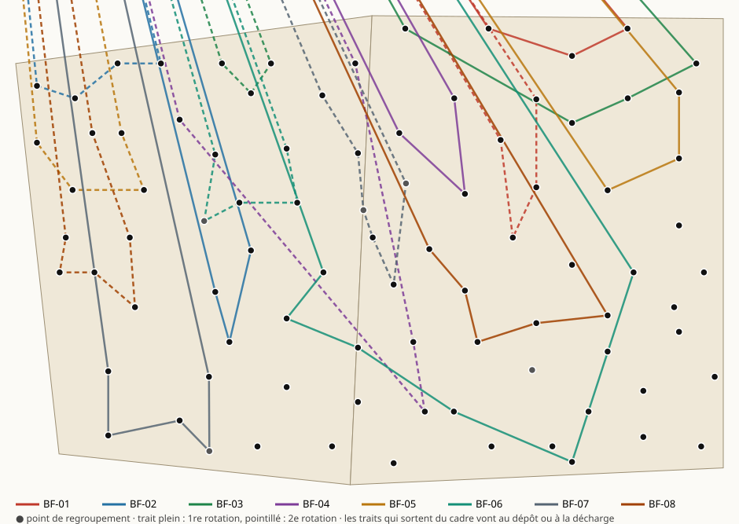
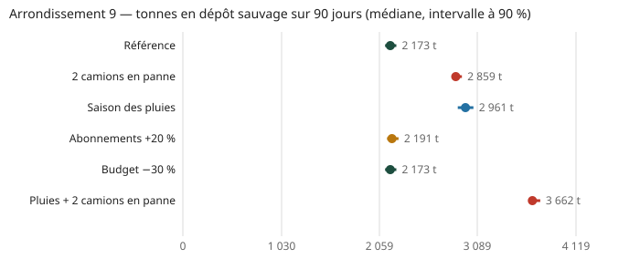
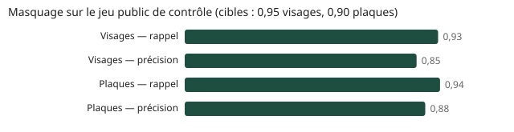
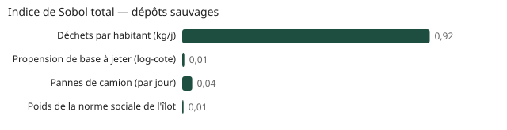

<!-- SPDX-License-Identifier: CC-BY-4.0 -->
# Salubri — rapport technique

Hackathon des universités 2026 (finale, thème Open Source), défi 01 « Assainissement de Ouaga ». Rapport du
dépôt au 17 novembre 2026 (version 0.4.0). Les chiffres viennent de calculs relancés dans le dépôt ; chaque section donne le
script ou le test qui les produit. Les figures sont tracées par `scripts/figures_rapport.py` et
`scripts/plan_arrondissement.py` depuis ces résultats.

## 1. Contexte

À Ouagadougou, une partie des déchets ménagers finit en dépotoirs sauvages : caniveaux, terrains vagues, abords
des barrages. La collecte repose sur trois acteurs : les ménages, les pré-collecteurs (charrettes, tricycles,
abonnement mensuel) qui vident dans des points de regroupement ou des centres de collecte et de transit (CCT),
et la mairie (camions vers la décharge, nettoyage des dépotoirs), appuyée par la brigade verte Laabal. Le défi
demande : repérer les dépotoirs avec les citoyens, placer les points de regroupement, organiser les tournées,
simuler la filière et ses aléas (pannes, saison des pluies), et livrer des données ouvertes.

## 2. Démarche

Une plateforme libre en trois applications qui partagent une API :

- **Salubri Go** (application web installable, hors ligne) : le citoyen signale un dépôt ; visages et plaques
  sont floutés **sur le téléphone avant l'envoi**, puis une seconde fois sur le serveur.
- **Salubri Map** : modération, carte des dépotoirs consolidés, exports (GeoJSON, CSV, OSM).
- **Salubri Sim** : scénarios (paramètres, flotte, quartiers actifs), plan recalculé en quelques secondes,
  différences avec la version précédente, simulation de la filière avec intervalles.

Principe : chaque changement (panne, saison, quartier, paramètre) crée une nouvelle version de plan, recalculée
seulement pour les étapes touchées, et mesurée contre la précédente (cohérence, § 6.3).

## 3. Architecture

FastAPI + PostgreSQL/PostGIS + OSRM (distances routières, profil saison sèche et saison des pluies), nginx,
deux applications React, Docker Compose (`docs/ARCHITECTURE.md`). Chaîne de calcul : E1 îlots (bâtiments
regroupés par ~30) → E2 demande → E3 points de regroupement → E4 matrice de distances → E5 tournées →
E6 simulation rapide → E7 différences et cohérence. Chaque étape a une clé de cache ; un changement ne recalcule
que l'aval de ce qu'il touche (`docs/REHEARSAL_REPORT.md` : étapes recalculées et en cache par événement).

## 4. Données

| Donnée | Source | Licence |
|---|---|---|
| Routes, cours d'eau, centres de santé | OpenStreetMap (extrait Geofabrik) | ODbL |
| Bâtiments | Google Open Buildings v3 (confiance ≥ 0,7) | CC BY 4.0 / ODbL |
| Quartiers et populations | jeu de **démonstration** (`quartiers.geojson`, `source: demo`) | — |
| CCT existants | SDGD 2020 (positions relevées) | à confirmer |
| Signalements | citoyens (Salubri Go), imports, collecte de l'équipe | ODbL (`COLLECTE_TERRAIN.md`) |

Limite principale : les limites et populations des quartiers sont des ordres de grandeur ; il faut les
remplacer par celles du recensement (INSD) — un seul fichier à changer (`docs/NOUVELLE_COMMUNE.md`).

## 5. Paramètres

Toutes les valeurs de départ sont dans `data/communes/ouagadougou/params_default.json`, décrites dans
`params_schema.json` (unité, intervalle plausible, source, modèles qui les utilisent) et dans
[`PARAMETRES.md`](PARAMETRES.md), généré. Une valeur hors intervalle est refusée au chargement. Les valeurs de
la mairie se chargent en une commande : `python -m salubri_api.params import mairie.json --simulation`, avec le
rapport des différences. La plupart des valeurs sont des **hypothèses** sourcées ; la sensibilité (§ 8.4) dit
lesquelles mesurer d'abord.

## 6. Modèles

### 6.1 Placement des points de regroupement

Problème d'optimisation résolu par CP-SAT (OR-Tools) : sites candidats sur les routes tous les ~50 m hors zones
d'exclusion (cours d'eau, bâtiments), points existants, centres d'un k-means pondéré (solution de départ et de
repli). On minimise la marche pondérée par la demande, avec pénalités pour un îlot au-delà de la distance de
marche (300 m), pour un point au-delà de sa capacité, un coût d'ouverture par point, et une **pénalité de
stabilité** : déplacer un point existant coûte comme faire marcher sa charge 300 m de plus. Objectif, borne et
écart sont rendus dans le plan (`summary.placement`). Tests : optimum égal à l'énumération sur de petites
instances (`tests/test_placement_opt.py`).

### 6.2 Tournées

VRP avec capacités, fenêtres horaires, deux rotations par camion et points abandonnables (OR-Tools, recherche
locale guidée). Chaque plan donne les km, une **borne inférieure garantie** et l'écart majorant
(`summary.vrp`). Banc d'essai ([`BENCHMARK_TOURNEES.md`](BENCHMARK_TOURNEES.md)) : sur la zone pilote, à 1 s,
0,7 % de la meilleure solution connue (9 exécutions) ; sur la ville entière, la flotte de démonstration
(8 camions) ne dessert que 74 points sur 1 034 : il manque des camions, pas du calcul. Le banc compare aussi
l'heuristique de repli (économies + 2-opt, utilisée si OR-Tools échoue) : 603,5 km et 6,8 t non desservies
contre 503,2 km et 0 t pour OR-Tools sur la zone pilote. Sans OSRM, les distances sont « vol d'oiseau ×
facteur » ; ce facteur est un paramètre par saison (1,35 / 1,5), calable sur OSRM par
`scripts/calibrer_detour.py` — mesure **à faire sur la machine de démonstration** (OSRM indisponible là où ce
rapport a été produit, [`DETOUR_CALIBRATION.md`](DETOUR_CALIBRATION.md)). Les demandes sont arrondies au kg
supérieur dans le solveur : un arrondi au plus proche avait laissé passer 8,001 t dans un camion de 8 t
(trouvé par la répétition, § 8.2).

### 6.3 Cohérence entre versions

Pour chaque nouvelle version : part des points inchangés, déplacement moyen et maximal, similarité de Jaccard
des paires (camion, point), écarts de coût et de km, couverture avant et après. La répétition vérifie qu'une
panne, la saison des pluies ou un nouveau quartier **ne déplacent aucun point existant** (100 % inchangés,
`docs/REHEARSAL_REPORT.md`). Limite constatée : après une panne, les tournées sont presque entièrement refaites
(Jaccard ≈ 0,1) car le VRP repart de zéro. La répétition enchaîne aussi **10 changements de paramètres tirés
au hasard** : chaque plan garde ≥ 70 % des points en place, un déplacement moyen sur tous les points ≤ 30 m et
sa couverture quand le paramètre ne touche pas au placement.

### 6.4 Simulation à agents (résumé ODD)

Protocole complet : [`SIMULATION_ODD.md`](SIMULATION_ODD.md).

- **Agents** : un par ménage (taille, revenu, distance au point, abonnement, habitude), pré-collecteurs
  (charrette, clients, comptes mensuels), brigade Laabal, mairie (tournées du plan, pannes, budget, nettoyage) ;
  points et dépotoirs passifs.
- **Pas d'un jour**, 90 jours : production → pré-collecte → choix des ménages (garder, porter, jeter : logit
  multinomial avec distance, point plein, pluie, crainte de l'amende, norme sociale de l'îlot, habitude) →
  camions → Laabal → nettoyage → fin de mois (abonnements, faillite ou extension des pré-collecteurs, budget).
- **Cohérence** : hétérogénéité coupée, la moyenne de 30 réplications reste à ±10 % du modèle agrégé
  (`tests/test_abm.py`). Construire le modèle à agents a révélé un biais du modèle agrégé (le pré-collecteur
  emportait des déchets de non-abonnés : 12 % de dépôts sauvages en moins), corrigé.
- **Vitesse** : 0,3 s pour 19 000 ménages, 5 s pour 357 000 (ville entière) sur 2 cœurs.
- **Incertitude** : 30 réplications par scénario, médiane et intervalle à 90 % (5ᵉ–95ᵉ centiles).
- **Paramètres** : les 34 paramètres de comportement des deux modèles sont dans le fichier documenté (section
  `comportement`, unité, intervalle, source) et modifiables par scénario.
- **Calage** : une seule référence chiffrée, les décharges sauvages du SDGD 2020 (4 dans la zone pilote).
  Simulée dans sa situation de 2019 (CCT existants seuls), la zone ne la reproduit pour **aucune** combinaison
  de `p0` × `slope_dist` au seuil de 10 t : le SDGD compte de grands sites, le modèle des tas par îlot. Les
  paramètres restent des hypothèses ; une référence de débit (tonnes de dépôts enlevées par mois) est à demander
  à la mairie ([`SIMULATION_CALIBRATION.md`](SIMULATION_CALIBRATION.md)).

## 7. Scénarios simulés — Arrondissement 9

Plan complet, tables par point et par tournée, coûts, personnel, risques et consignes de saison des pluies :
[`PLAN_ARRONDISSEMENT_9.md`](PLAN_ARRONDISSEMENT_9.md) (et le PDF). Six variantes, 30 réplications chacune : référence, 2 camions en panne, saison des pluies,
+20 % d'abonnements, budget −30 %, pluies + 2 camions en panne. Population réelle de l'arrondissement :
336 483 habitants (INSD, RGPH 2019), 3,2 fois la population de démonstration simulée ; les limites des
secteurs 37 à 40 ne sont pas en données ouvertes (à demander à la mairie).

Lecture : la capacité de chaque point par enlèvement est une contrainte dure du placement ; à 2 enlèvements par
semaine elle est impossible avec 80 points au plus, le plan passe donc à 3 (lundi, mercredi, vendredi). La
saison des pluies et la perte de deux camions augmentent nettement les dépôts sauvages ; +20 % d'abonnements ne
change presque rien tant que la capacité des pré-collecteurs ne suit pas. Le budget −30 % ne change rien : le
plan reste sous le budget réduit. Avec 8 camions, 1 point n'est pas desservi ; le plan publie la flotte actuelle
et la flotte nécessaire (9 camions) avec leur coût et leurs dépôts sauvages simulés.

## 8. Validation

### 8.1 Tests

API : 213 tests (pytest, base PostGIS réelle), couverture de code 92 % (≥ 91 % exigé en CI) ; applications :
22 tests Vitest ; parcours complets dans un vrai navigateur (Playwright, `tests/e2e`, 20 tests dont le
signalement hors ligne avec masquage, le mode manuel et la ligne de licence de la carte publique). CI : ruff épinglé, tests, builds, à chaque push.

### 8.2 Répétition du test en direct

`scripts/rehearse.py` rejoue les pièges anti-triche (photo réutilisée, GPS faux, hors commune, pourriel…) et les
changements de scénario du jury (pannes, pluie, budget, nouveau quartier) contre la pile lancée ; chaque
recalcul doit tenir en quelques secondes et respecter les invariants. Résultat et durées :
[`REHEARSAL_REPORT.md`](REHEARSAL_REPORT.md). S'y ajoutent 10 changements de paramètres tirés au hasard
(§ 6.3) ; le premier passage a trouvé une vraie erreur (surcharge de 1 kg due à un arrondi), corrigée.

### 8.3 Masquage des visages et des plaques

Sur un jeu public de contrôle (WIDER Face et plaques Roboflow, **pas Ouagadougou**) : rappel 0,933 sur les
visages au téléphone, 0,938 avec la seconde passe du serveur (cible 0,95 **non atteinte** ; petits visages
0,875), 0,935 sur les plaques. Image de travail de 1 280 px et tuiles de 512 px pour les petits visages :
2,2 s par photo sur un profil de téléphone ralenti ×4 (4,9 s la première). Aucune photo non masquée n'est
publiée : mode manuel avec zone tracée ou confirmation, et photo mise de côté (dossier privé, « à vérifier »)
si la détection du serveur échoue. Le jeu de terrain (≥ 60 photos de l'équipe) reste
à constituer (`data/eval/masquage/README.md`). Détails : [`MASQUAGE.md`](MASQUAGE.md).

### 8.4 Sensibilité

30 réplications au point nominal (médiane et intervalle à 90 % de chaque indicateur), Morris puis Sobol sur les
8 paramètres : la quantité de déchets par habitant explique ~93 % de la variance des dépôts sauvages (S1) ; les
hypothèses de comportement pèsent peu dans leurs bornes.
[`SIMULATION_SENSIBILITE.md`](SIMULATION_SENSIBILITE.md).

## 9. Limites

- Quartiers et populations de démonstration ; plan de l'arrondissement 9 approximatif tant qu'ils ne sont pas
  remplacés.
- Paramètres de comportement des ménages non calés : la seule référence (SDGD 2020) ne suffit pas ; les
  simulations comparent des scénarios, elles ne prédisent pas.
- Facteur de détour sans OSRM pas encore mesuré contre OSRM.
- Masquage : rappel visages sous la cible sur le jeu de contrôle, pas encore mesuré à Ouagadougou ; un bouton
  « flouter une zone » reste indispensable.
- Tournées refaites entièrement après une panne ; pas de démarrage depuis les tournées précédentes.
- Flotte de démonstration insuffisante pour la ville entière.

## 10. Modules optionnels (hors des livrables exigés)

Deux modules, éteints par défaut, s'ajoutent sans rien changer quand ils sont éteints (vérifié : plans recalculés
identiques, modules éteints, sur une copie de la même base avec des solveurs reproductibles). Détails :
[`MODULES.md`](MODULES.md).

- **Saisons** : état des routes par période (import, signalement « Route impraticable » vérifié par un modérateur,
  saisie sur la carte). Un point dont la route d'accès est coupée en saison des pluies est déplacé en gardant ses
  ménages à portée, ou signalé inaccessible et non desservi ; le retour en saison sèche rend les positions
  d'origine ; les tournées évitent les routes coupées. Approximations simples (couloir infranchissable de 10 m,
  pénalité de 50 km) décrites dans `HYPOTHESES.md`. Vérifié sur la carte synthétique, pas sur de vraies routes
  coupées.
- **Assistant** : un modèle de langue local (Ollama, LM Studio, llama.cpp…, API compatible OpenAI) explique plans,
  simulations et signalements aux agents de la mairie, à partir d'outils en lecture seule et des documents du dépôt
  (BM25), en citant ses sources ; il ne modifie rien et ne juge pas un signalement. Testé avec un modèle simulé ;
  la qualité des réponses d'un vrai modèle n'est pas encore mesurée (30 questions prêtes).

## 11. Réutilisation dans une autre commune

Un dossier `data/communes/<commune>/` (quartiers, paramètres, CCT), un extrait OSM et les bâtiments Open
Buildings de l'emprise suffisent ; `scripts/new_commune.py` prépare le dossier et la procédure est dans
[`NOUVELLE_COMMUNE.md`](NOUVELLE_COMMUNE.md). Les paramètres sont vérifiés par le même schéma ; le code ne
contient rien de propre à Ouagadougou. Licences : code AGPL-3.0, documents CC BY 4.0, données ODbL ; briques
réutilisées et leurs licences dans [`LICENCES_TIERCES.md`](LICENCES_TIERCES.md) et
[`MATRICE_CONTRIBUTION.md`](MATRICE_CONTRIBUTION.md).
