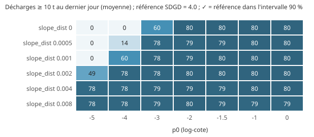

<!-- SPDX-License-Identifier: CC-BY-4.0 -->
# Calage et validation de la simulation

Généré par `scripts/calibrer_simulation.py` le 2026-11-17 — Zone pilote, plan v56 ramené aux CCT existants (situation 2019), 59 900 habitants,
modèle à agents, horizon 90 jours, 6 graines par case, 252
simulations en 28 s. Ne pas modifier à la main : relancer le script.

## Question

Les deux paramètres libres qui décident si un ménage jette sont **`p0`** (propension de base, point hors de
portée) et **`slope_dist`** (effet de chaque mètre de marche au-delà de la limite). Aucune enquête ne les donne.
Peut-on les caler sur la seule référence chiffrée du dépôt : le SDGD 2020 ?

Référence : **58 décharges sauvages** recensées dans toute la commune (enquête 2019,
`docs/HYPOTHESES.md`). Rapportées à la population (RGPH 2019 : 2 415 266 habitants, INSD), la zone
simulée (59 900 habitants) devrait en compter 1,44. Sur la carte numérisée du SDGD (`sdgd2020.geojson`, ± 500 m), **4** décharge(s) sauvage(s) tombe(nt) dans la zone active : c'est la **référence retenue**, plus locale que la règle de trois (1,44).

Situation simulée : celle de 2019, pas le plan. Chaque îlot n'a que le **CCT existant le plus proche** (carte du
SDGD, distance à vol d'oiseau × 1,2), desservi par les camions du plan. Analogue d'une « décharge » : un dépôt
sauvage dont le stock au dernier jour atteint un seuil (10 t, soit une vingtaine de m³ ; 5 t et 20 t en contrôle).

## Résultat

**Aucune combinaison** de la grille ne reproduit la référence au seuil de 10 t.

Décharges ≥ 10 t au dernier jour (moyenne sur 6 graines) et, entre parenthèses, part des déchets
produits jetée sur la période ; ✓ = la référence est dans l'intervalle 90 % des simulations :

| `slope_dist` \ `p0` | -5,0 | -4,0 | -3,0 | -2,0 | -1,5 | -1,0 | 0,0 |
|---|---|---|---|---|---|---|---|
| 0 | 0 (16 %) | 0 (34 %) | 60 (66 %) | 80 (89 %) | 80 (92 %) | 80 (93 %) | 80 (93 %) |
| 0.0005 | 0 (24 %) | 14 (49 %) | 78 (80 %) | 79 (92 %) | 79 (93 %) | 80 (93 %) | 80 (93 %) |
| 0.001 | 0 (35 %) | 60 (65 %) | 78 (86 %) | 79 (92 %) | 80 (93 %) | 80 (93 %) | 80 (93 %) |
| 0.002 | 49 (61 %) | 78 (80 %) | 78 (90 %) | 80 (93 %) | 80 (93 %) | 80 (93 %) | 80 (93 %) |
| 0.004 | 78 (80 %) | 78 (88 %) | 79 (92 %) | 79 (93 %) | 79 (93 %) | 80 (94 %) | 80 (93 %) |
| 0.008 | 78 (88 %) | 78 (91 %) | 79 (93 %) | 80 (93 %) | 79 (93 %) | 79 (94 %) | 79 (93 %) |

| Seuil d'une « décharge » | Cases compatibles | (`p0` ; `slope_dist`) compatibles | Valeur aux paramètres actuels |
|---|---|---|---|
| ≥ 5 t | 2 / 42 | (-4,0 ; 0), (-5,0 ; 0.001) | 80 |
| ≥ 10 t | 0 / 42 | aucune | 79 |
| ≥ 20 t | 0 / 42 | aucune | 62 |

## Ce qu'on en conclut

- Avec les CCT de 2019, la marche moyenne dépasse 1 km : le modèle fait finir en dépôt sauvage
  plus de 90 % des déchets dès que `p0` dépasse -2 (pré-collecteurs compris, qui déchargent au plus près quand le
  CCT est loin), et chaque îlot finit avec un tas de plusieurs tonnes. Le SDGD, lui, ne compte
  que les grandes décharges cartographiables de la ville. **L'analogue « un îlot = une décharge possible » ne
  correspond pas à ce que compte le SDGD** : les deux chiffres ne mesurent pas la même chose.
- Les rares cases compatibles demandent que presque personne ne jette même à 1 km du CCT, ce que contredisent
  les dépôts visibles dans tous les quartiers. Les retenir serait caler le modèle sur un artefact.
- **Décision** : `p0` et `slope_dist` gardent leurs valeurs d'hypothèse (`docs/PARAMETRES.md`), marquées « non
  calé ». La sensibilité des résultats à ces deux paramètres est mesurée dans `docs/SIMULATION_SENSIBILITE.md` ;
  les écarts entre scénarios (comparaison de plans) y sont moins sensibles que les niveaux absolus.
- La situation 2019 simulée est grossière : capacité des CCT prise égale à celle des points du plan, pas de
  ramassage informel, pas de stock ancien (une décharge du SDGD peut avoir des années).

## À faire par l'équipe

Obtenir de la mairie (DPAE / DSPH de l'arrondissement) une référence de **débit**, plus proche du modèle qu'un
décompte de sites : tonnes de dépôts sauvages enlevées par mois, ou part des ménages abonnés à la pré-collecte
dans l'arrondissement. Le script se relance alors avec cette cible (une ligne à changer : `reference`).
