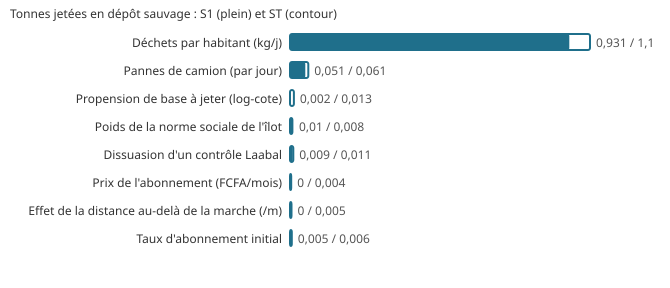

<!-- SPDX-License-Identifier: CC-BY-4.0 -->
# Incertitude et sensibilité du modèle à agents

Généré par `scripts/sensibilite.py` le 2026-11-17 — Zone pilote, plan v56, horizon 90 jours, 2 graines par point, 5330 simulations en 602 s. Ne pas modifier à la main : relancer le script.

## 0. Incertitude propre au modèle : 30 réplications au point nominal

Mêmes paramètres, 30 graines. Médiane et intervalle à 90 % (5ᵉ – 95ᵉ centile) de chaque indicateur sur l'horizon. C'est ce que montre le tableau de bord (bandes autour des courbes).

| Indicateur | Médiane | Intervalle 90 % |
|---|---|---|
| `produced_t` | 3 236 | 3 223 – 3 249 |
| `collected_t` | 2 995 | 2 920 – 3 063 |
| `precollected_t` | 187 | 187 – 187 |
| `wild_dump_t` | 136 | 76 – 192 |
| `wild_dumps_active_final` | 0 | 0 – 0 |
| `wild_dumps_active_mean` | 0 | 0 – 0 |
| `cleanup_t` | 135 | 75,1 – 191 |
| `laabal_controls` | 228 | 228 – 228 |
| `laabal_cleared_t` | 0,89 | 0,417 – 1,37 |
| `mean_cleanup_delay_days` | 1 | 1 – 1 |
| `overflow_point_days` | 404 | 238 – 574 |
| `truck_km` | 13 265 | 12 903 – 13 618 |
| `cost_total_fcfa` | 10 364 094 | 10 084 128 – 10 626 875 |
| `cost_per_t` | 3 466 | 3 428 – 3 484 |
| `coverage_rate` | 0,933 | 0,907 – 0,956 |
| `subscription_rate_final` | 0,302 | 0,299 – 0,312 |
| `precollectors_dropped` | 0 | 0 – 0 |
| `recurring_dumps` | 37,5 | 19,8 – 51,6 |
| `mass_balance_error` | 0 | 0 – 0 |
| `households` | 8 557 | 8 557 – 8 557 |
| `precollectors_active_final` | 6 | 6 – 6 |
| `precollector_income_mean_fcfa` | 785 500 | 765 812 – 806 375 |
| `budget_left_final_fcfa` | 25 000 000 | 25 000 000 – 25 000 000 |
| `laabal_fines` | 2 230 | 1 340 – 3 155 |
| `voluntary_t` | 2 897 | 2 837 – 2 951 |

## Paramètres étudiés

| Paramètre | Bornes | Source des bornes |
|---|---|---|
| Déchets par habitant (kg/j) (`kg_per_person_day`) | 0,4 – 0,9 | 0,6 annoncé par la mairie ; ±50 % selon quartier |
| Taux d'abonnement initial (`subscription_rate`) | 0,2 – 0,5 | hypothèse 35 %, aucune enquête |
| Prix de l'abonnement (FCFA/mois) (`fee_fcfa_month`) | 500 – 3 000 | tarifs observés 1 000 à 2 500 |
| Propension de base à jeter (log-cote) (`p0`) | -2,5 – -0,5 | hypothèse |
| Effet de la distance au-delà de la marche (/m) (`slope_dist`) | 0,002 – 0,008 | hypothèse |
| Dissuasion d'un contrôle Laabal (`laabal_deterrence`) | 0,2 – 0,8 | hypothèse |
| Poids de la norme sociale de l'îlot (`beta_norme`) | 0 – 4 | hypothèse |
| Pannes de camion (par jour) (`breakdown_rate`) | 0,01 – 0,1 | 2 % par défaut ; parc vieillissant |

## 1. Criblage de Morris (μ*, unités de la sortie)

μ* = effet moyen absolu quand le paramètre parcourt les 2/3 de son intervalle. Plus il est grand, plus le paramètre compte.

| Paramètre | Tonnes jetées en dépôt sauvage | Tonnes collectées par camion | Coût de la mairie à la tonne | Taux d'abonnement final |
|---|---|---|---|---|
| Déchets par habitant (kg/j) | 1 758 | 648 | 1 060 | 0,0389 |
| Taux d'abonnement initial | 36,1 | 61 | 36,5 | 0,124 |
| Prix de l'abonnement (FCFA/mois) | 40,9 | 48,8 | 30,1 | 0,125 |
| Propension de base à jeter (log-cote) | 212 | 56,8 | 56,5 | 0,0039 |
| Effet de la distance au-delà de la marche (/m) | 40,2 | 39,6 | 38,5 | 0,0042 |
| Dissuasion d'un contrôle Laabal | 58,9 | 62,8 | 63,6 | 0,0063 |
| Poids de la norme sociale de l'îlot | 89,6 | 97,2 | 40,5 | 0,0026 |
| Pannes de camion (par jour) | 315 | 334 | 207 | 0,0043 |

## 2. Indices de Sobol sur les 8 paramètres, classés par Morris

S1 = part de la variance de la sortie due au paramètre seul ; ST = part totale, interactions comprises. Entre crochets : intervalle de confiance à 95 % (bootstrap). Avec peu d'échantillons, les intervalles sont larges : l'ordre des paramètres compte plus que les valeurs.

### Tonnes jetées en dépôt sauvage

Hasard propre au modèle : 0,3 % de la variance.

| Paramètre | S1 | ST |
|---|---|---|
| Déchets par habitant (kg/j) | 0,931 [0,787 ; 1,08] | 1,1 [0,966 ; 1,23] |
| Pannes de camion (par jour) | 0,051 [0,016 ; 0,088] | 0,061 [0,05 ; 0,076] |
| Propension de base à jeter (log-cote) | 0,002 [-0,021 ; 0,025] | 0,013 [0,01 ; 0,016] |
| Poids de la norme sociale de l'îlot | 0,01 [-0,004 ; 0,027] | 0,008 [0,007 ; 0,01] |
| Dissuasion d'un contrôle Laabal | 0,009 [-0,009 ; 0,026] | 0,011 [0,008 ; 0,014] |
| Prix de l'abonnement (FCFA/mois) | -0,002 [-0,01 ; 0,007] | 0,004 [0,003 ; 0,005] |
| Effet de la distance au-delà de la marche (/m) | 0 [-0,012 ; 0,011] | 0,005 [0,004 ; 0,006] |
| Taux d'abonnement initial | 0,005 [-0,01 ; 0,019] | 0,006 [0,005 ; 0,008] |

### Tonnes collectées par camion

Hasard propre au modèle : 1,1 % de la variance.

| Paramètre | S1 | ST |
|---|---|---|
| Déchets par habitant (kg/j) | 0,859 [0,717 ; 1,03] | 0,826 [0,719 ; 0,98] |
| Pannes de camion (par jour) | 0,124 [0,052 ; 0,198] | 0,188 [0,152 ; 0,22] |
| Propension de base à jeter (log-cote) | -0,005 [-0,027 ; 0,023] | 0,019 [0,014 ; 0,022] |
| Poids de la norme sociale de l'îlot | -0,002 [-0,028 ; 0,023] | 0,021 [0,017 ; 0,027] |
| Dissuasion d'un contrôle Laabal | -0,002 [-0,026 ; 0,02] | 0,02 [0,015 ; 0,025] |
| Prix de l'abonnement (FCFA/mois) | -0,002 [-0,021 ; 0,018] | 0,014 [0,011 ; 0,017] |
| Effet de la distance au-delà de la marche (/m) | -0,005 [-0,024 ; 0,014] | 0,014 [0,011 ; 0,018] |
| Taux d'abonnement initial | -0,019 [-0,042 ; 0,006] | 0,018 [0,015 ; 0,022] |

### Coût de la mairie à la tonne

Hasard propre au modèle : 0,1 % de la variance.

| Paramètre | S1 | ST |
|---|---|---|
| Déchets par habitant (kg/j) | 1,04 [0,853 ; 1,25] | 1,04 [0,917 ; 1,18] |
| Pannes de camion (par jour) | -0,006 [-0,035 ; 0,024] | 0,036 [0,026 ; 0,045] |
| Propension de base à jeter (log-cote) | -0,002 [-0,011 ; 0,009] | 0,004 [0,002 ; 0,005] |
| Poids de la norme sociale de l'îlot | -0,006 [-0,015 ; 0,002] | 0,003 [0,002 ; 0,004] |
| Dissuasion d'un contrôle Laabal | 0,003 [-0,006 ; 0,012] | 0,003 [0,002 ; 0,003] |
| Prix de l'abonnement (FCFA/mois) | -0,002 [-0,012 ; 0,007] | 0,003 [0,002 ; 0,004] |
| Effet de la distance au-delà de la marche (/m) | 0 [-0,008 ; 0,008] | 0,002 [0,001 ; 0,002] |
| Taux d'abonnement initial | 0,002 [-0,009 ; 0,013] | 0,006 [0,005 ; 0,008] |

### Taux d'abonnement final

Hasard propre au modèle : 0,5 % de la variance.

| Paramètre | S1 | ST |
|---|---|---|
| Déchets par habitant (kg/j) | 0,042 [0,005 ; 0,078] | 0,056 [0,045 ; 0,07] |
| Pannes de camion (par jour) | 0,002 [-0,009 ; 0,012] | 0,003 [0,003 ; 0,004] |
| Propension de base à jeter (log-cote) | -0,003 [-0,014 ; 0,008] | 0,004 [0,003 ; 0,005] |
| Poids de la norme sociale de l'îlot | 0,002 [-0,009 ; 0,013] | 0,003 [0,003 ; 0,004] |
| Dissuasion d'un contrôle Laabal | -0,006 [-0,018 ; 0,005] | 0,003 [0,003 ; 0,004] |
| Prix de l'abonnement (FCFA/mois) | 0,396 [0,317 ; 0,505] | 0,423 [0,366 ; 0,498] |
| Effet de la distance au-delà de la marche (/m) | 0 [-0,009 ; 0,009] | 0,003 [0,002 ; 0,003] |
| Taux d'abonnement initial | 0,43 [0,339 ; 0,527] | 0,4 [0,337 ; 0,476] |
