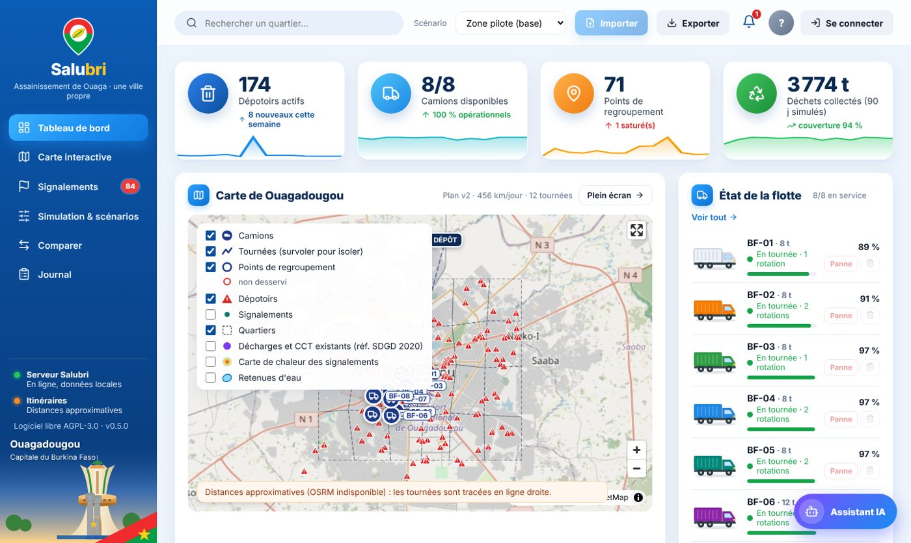
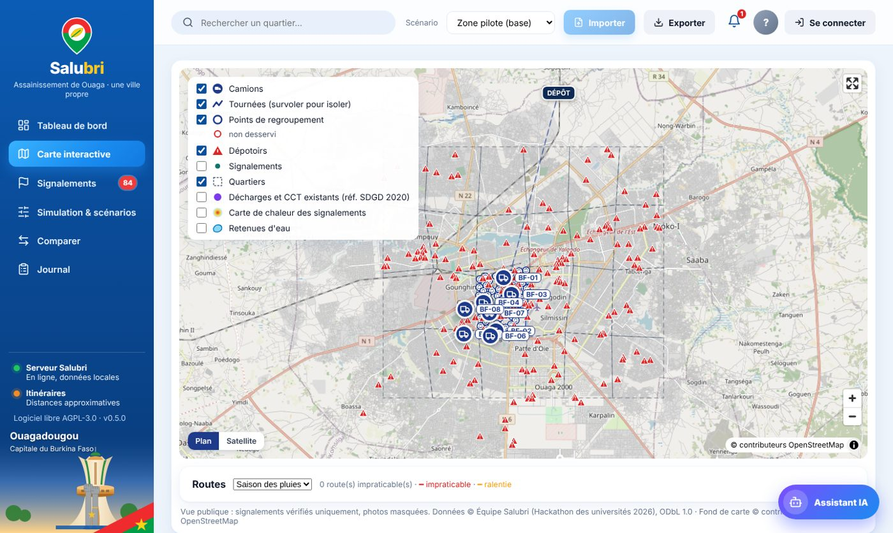
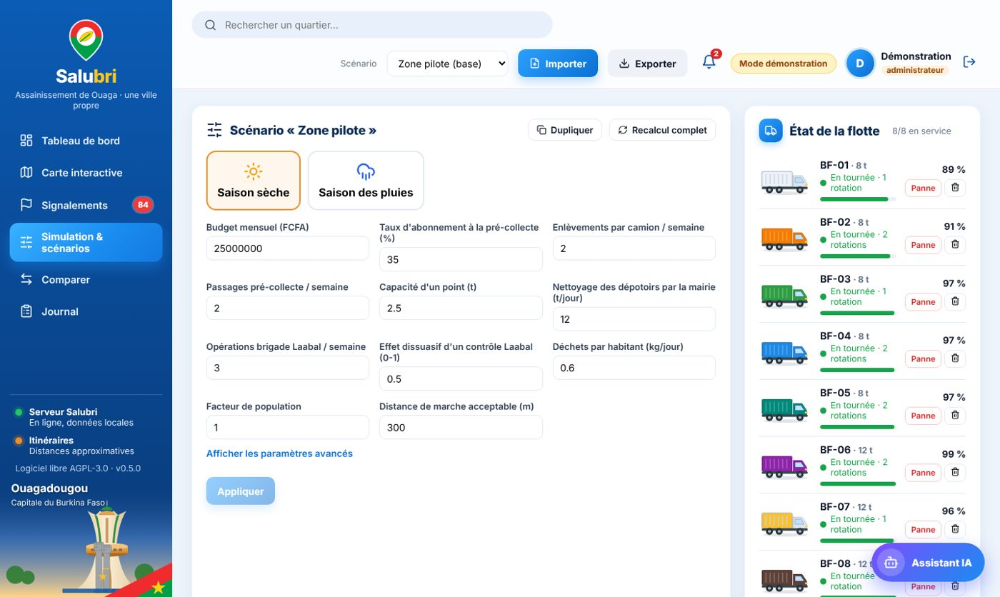
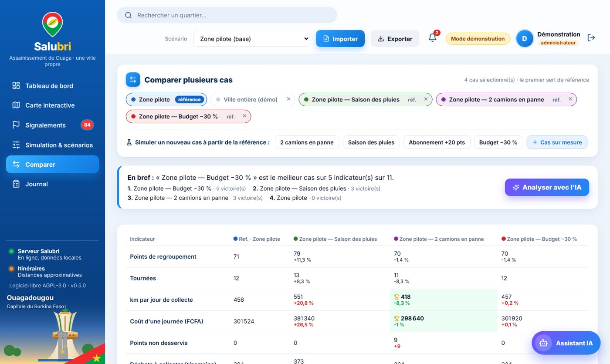

<!-- SPDX-License-Identifier: CC-BY-4.0 -->
# 3 — Tableau de bord des scénarios et plan de gestion d'un arrondissement

**Application** : Salubri Map et Salubri Sim ([`apps/web`](../../apps/web)), ouverts par `SALUBRI.bat` (choix 1 puis 3) sur `http://localhost/`.
On y crée un scénario, on change un paramètre (camions en panne, saison des pluies, budget, nouveau quartier) et le plan est
recalculé en environ une seconde, avec la cohérence avec la version précédente ; l'onglet « Comparer » met les scénarios côte à côte.

| Captures | |
|---|---|
|  |  |
|  |  |

**Plan de gestion de l'arrondissement 9** : [`PLAN_ARRONDISSEMENT_9.pdf`](PLAN_ARRONDISSEMENT_9.pdf) (points de regroupement,
tournées, coût, indicateurs simulés avec intervalles). Régénération : `python scripts/plan_arrondissement.py --arrondissement 9`.
Limite écrite : quartiers de démonstration (population réelle INSD 2019 : 336 483 hab.) tant que les limites des secteurs 37 à 40 ne sont pas chargées.
